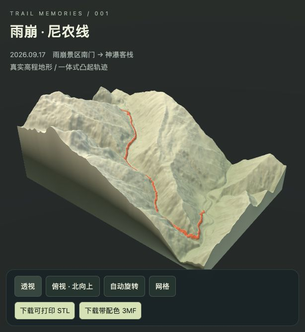
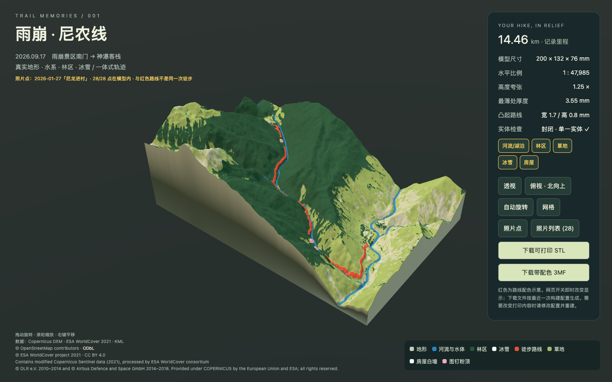
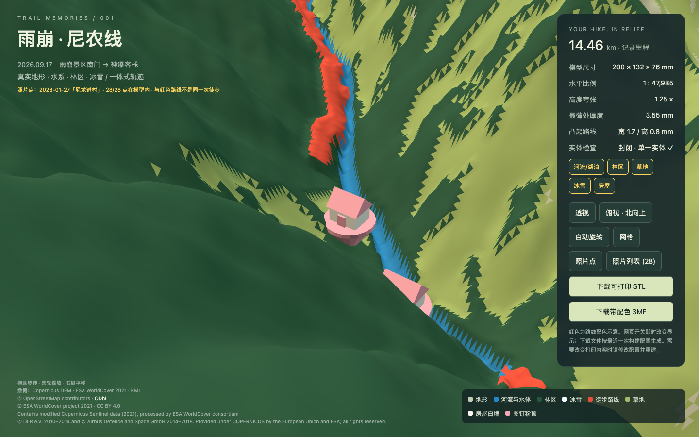

# 徒步轨迹 3D 地形模型 — 产品方案

> 状态：雨崩 · 尼农线本地原型已跑通，尚未完成切片和实物打印验收。  
> 整理日期：2026-10-21；当前基线：路线断口 4.0 mm、浅粉图钉屋、南侧海拔刻度、全部元素开启。  
> 关联方案：`docs/徒步轨迹3D地形模型-技术方案.md`。全文工程路径相对项目根目录；图片地址相对本文所在目录。

## 1. 背景与目标

### 1.1 我们准备做什么

把两步路等导航软件记录的徒步轨迹，与路线周围的真实山体、水系和地表分类结合，生成可以在本机浏览、导出并交给 3D 打印软件处理的纪念地形模型。

用户最初提出的是每次约 10–30 公里的徒步纪念需求，这是目标使用范围，不是本项目已经验证的批量适用范围。本期只跑通雨崩 · 尼农线这份样本，优先让有编程经验、缺少三维开发和打印经验的使用者走完“导出轨迹 → 看见山谷与路线 → 按需开关元素 → 获得打印文件”的流程。

### 1.2 当前样本与边界

| 对象 | 实际内容 | 产品含义 |
| --- | --- | --- |
| 地形与红色主路线 | `data/route.kml` / `data/route.kmz`，2026-09-17，雨崩景区南门 → 神瀑客栈 | 同一条基础轨迹；当前输入不是任意格式通用导入器 |
| 照片与建筑判断 | `data/photos-2026-01-27/`，2026-01-27「尼龙进村」 | 是另一次徒步的叠加资料，不应伪装成主路线当天的记录 |
| 数据事实 | 轨迹 2,970 点，记录里程 14.455879607 km；坐标重算 14.219555825 km | 页面显示记录里程约 14.46 km，算法口径不同须保留说明 |
| 当前交付 | 本地网页、STL、带面材质 3MF、配置、数据来源与校验记录 | 已完成几何与交互原型，不等于已经试打成功 |

## 2. 用户与使用场景

### 2.1 主要用户

- 徒步爱好者：希望把一段山谷、步行经历和照片记忆转成桌面纪念物。
- 具备编程经验的个人创作者：希望能修改配置和房屋判断，不依赖手工雕刻完整山体。
- 后续负责打印的人：需要单位清楚、底面平整、封闭且连通的模型，并了解颜色和切片兼容性。

### 2.2 使用流程

| 场景 | 用户动作 | 当前结果 |
| --- | --- | --- |
| 制作基础模型 | 提供本期格式的 KML/KMZ，使用缓存 DEM 重建 | 地形、凸起路线、平底实体 |
| 突出沿途环境 | 开启河流、林区、草地、冰雪 | 水槽、林区纹理与分类配色；不虚构树木或雪线 |
| 回看旅行记忆 | 打开照片点，悬停或点击编号，切换照片列表 | 时间、DEM 海拔、经纬度和本地照片 |
| 增删纪念房屋 | 修正 `data/photo_houses.json`，重新构建 | 对启用的判断点放置图钉屋，并让路线避开 |
| 比较风格 | 在网页即时切换图层、旋转或俯视 | 显示即时更新，下载文件不自动跟随运行时开关 |
| 准备打印 | 修改配置重建，下载 STL 或 3MF | 按最近一次构建配置生成的实体；切片、机器参数与试打仍需另行完成 |

## 3. 核心功能与完成状态

| 功能 | 当前实现 | 边界 |
| --- | --- | --- |
| 真实地形 | Copernicus GLO-30 裁剪、投影、网格封底 | 原始约 30 m DSM；重采样不会生成真实细节 |
| 凸起路线 | 基底宽 1.7 mm、最高抬升 0.8 mm，贴合地表 | 房屋周围断开；不保证所有设备都能还原每处细节 |
| 河流、溪流、湖泊 | OSM 数据；水系下压 0.45 mm，湖面局部整平，蓝色 | 水槽宽为可打印符号，不是实测河宽或水位 |
| 林区 | WorldCover 与 OSM 林地；实际抬升约 0.321–0.439 mm、轻微程序纹理 | 不是逐棵树建模，整体台阶大于 0.2 mm 参考层高 |
| 草地、冰雪 | 草地浅绿、冰雪白，不改高程 | 冰雪来自分类及冰川面，非徒步当天实况 |
| 照片点 | 28 点全部在范围内；本地大图、缩略图、悬停、弹窗、列表 | 只在网页出现，不额外生成打印标记 |
| 建筑初判 | 原图逐张查看；5 个 true、3 个 uncertain、20 个 false | 人工可修正的初判，不是自动建筑定位系统 |
| 图钉屋 | 白墙、浅粉图钉与屋顶；打印并入地形，网页独立 GLB | 位于拍摄者坐标，陡坡可部分嵌入山体 |
| 路线断口 | 每个启用房屋周围 4.0 mm 中心半径，取消凸起及红色 | 网格额外留白，实际清空范围可能比配置圆大 |
| 元素配置 | 七类统一配置、构建 CLI 覆盖、网页即时开关 | 开关不会删除保留的原始数据；照片仅改变网页层 |
| 海拔刻度 | 南侧按轨迹首尾海拔等分四条深灰浮雕，网页可开关，S/E 标记起终点 | 数字取整，几何按真实 DEM 海拔换算 |
| 打印导出 | 单实体 STL / 9 种面材质的 3MF | STL 无颜色及标准单位声明；3MF 材质兼容性需切片确认 |
| 本地三维预览 | three.js、本地资源、旋转缩放、透视/俯视/自动旋转/网格 | 已有外部渲染截图；当前代理内 DOM 检查不等于浏览器验收 |

## 4. 交互与视觉设计

### 4.1 界面结构

主画布展示山体，左侧说明路线日期和照片的独立来源，右侧提供尺寸、比例、最薄处、路线参数、元素开关和下载入口。图例随启用状态更新。数据署名现收纳于右侧面板默认折叠的“数据来源”。

默认透视用于看山谷起伏和立体纪念效果；北向上俯视用于判断路线与河道位置。拖动旋转、滚轮缩放、右键平移。自动旋转便于总览，网格按钮便于观察地形三角网格；当前网格按钮主要控制地形材质，独立房屋 GLB 不自动切换线框。

### 4.2 当前配色

| 材质 ID | 类别 | 色值 |
| --- | --- | --- |
| 0 | 地形 | `#C6CBB5` |
| 1 | 河流与水体 | `#2389C9` |
| 2 | 林区 | `#24563B` |
| 3 | 冰雪 | `#F5FAFF` |
| 4 | 徒步路线 | `#E94F39` |
| 5 | 草地 | `#A2B96A` |
| 6 | 房屋白墙 | `#F7F7F2` |
| 7 | 图钉粉顶 | `#F4A7B9` |
| 8 | 海拔刻度 | `#39434B` |

照片编号使用 `#FFD45E` 黄色与深色描边，区别于打印类别。图钉屋的门与图钉、屋顶共用 accent 材质，因此也随粉色配置更新；白墙不变。粉色方案来自与路线红撞色后的调整，不代表真实建筑颜色。

### 4.3 房屋与路线的视觉关系

当前不再要求“路线高于房屋”。规则是：**房屋处路线留白，其他区域路线高于原始地形和已修改地表中较高者**。这样既保留路线识别性，也避免在屋顶上出现红色条带。

房屋缩放保持 1.0，设计原始尺寸约 3.40 × 3.40 × 3.95 mm，底部下沉 0.4 mm。全景中偏小与陡坡部分嵌入是已知现状，本轮没有放大房屋、抬高基座或调整坡面。看近景时可关闭照片点，避免黄色编号遮挡房屋。

### 4.4 照片交互与信息可信度

悬停显示标注时间及 DEM 海拔，点击显示本地大图、时间、海拔和经纬度；列表提供缩略图、上/下一张。时间来自 KML 的毫秒 `Time` 字段，按 Asia/Shanghai 显示，未核验 EXIF。原始名称和备注为空，采用“照片编号”，不编造标题。界面明确提示这些点来自另一场徒步。

### 4.5 效果参考



图源：`web/preview.png`，初版留档，不代表当前要素、房屋或断口状态。





图源：`work/preview-pink-a.png`、`work/preview-pink-b.png`，已有外部生成的浅粉方案截图。属于历史视觉参考，不能据此认定断口已经是当前 4.0 mm；当前几何数值以 `models/validation.json` 为准。本次仅复制图片，没有生成截图。

## 5. 配置与日常修改

配置入口为 `config/features.json`，详细字段和有效范围见技术方案第 5 节。

| 分组 | 用户能改什么 | 当前值 |
| --- | --- | --- |
| `rivers` | 启用、槽深、河流/溪流符号宽度 | 开；0.45 / 1.4 / 1.1 mm |
| `forest` | 启用、抬升、纹理幅度 | 开；0.32 / 0.12 mm |
| `grass` / `snow` | 类别开关 | 均开；只改颜色 |
| `houses` | 启用、判断表、uncertain 策略、设计路径、缩放、下沉、路线断口、净距门槛、粉色 | 开；默认不含 uncertain；1.0×、0.4 mm 下沉、4.0 mm 断口、`#F4A7B9` |
| `photos` | 是否构建照片叠加层 | 开；照片不加入打印几何 |

修改房屋：编辑 `data/photo_houses.json` 中对应记录的 `has_house`（JSON `true` / `false` / 字符串 `"uncertain"`），保留编号与经纬度，并在 `reason` 记录判断。默认 true 为 **7、12、20、23、25**；uncertain 为 **1、18、19**。开启 `include_uncertain` 后，这些点也放屋并留断口。

重建命令均在项目根目录执行：

```sh
.venv/bin/python build_model.py
.venv/bin/python build_model.py --disable rivers,forest
.venv/bin/python build_model.py --disable houses
```

网页开关适合即时比较；要改变 STL/3MF，必须修改配置或用 CLI 再构建。关闭房屋会去除房屋和对应断口，恢复完整路线。`min_route_clearance_mm` 当前为 0.0，另有“实际净距必须严格大于 0”的检查，不允许接触或压屋。

## 6. 已完成迭代记录

按实际需求推进顺序整理；基础模型及 KMZ 兼容属于前序工作，后续要素、照片、房屋和断口调整为本轮累计迭代，不给缺少记录的环节虚构时分或发布版本号。历史数值依据 `README.md`、`work/before-route-gaps.json`、历史构建配置以及需求记录；当前值以统一配置为准。

| 顺序 | 改动 | 原因与结果 |
| --- | --- | --- |
| 基础样本 | 从两步路 KML 与真实 DEM 生成山体、凸起路线、平底和预览 | 先跑通从轨迹到打印实体，而不是手工捏假山 |
| KMZ 兼容 | 从 ZIP 中读 `doc.kml` | 用户提供 KMZ；本期 KML/KMZ 内容一致，不额外改变几何 |
| 地表元素 | 增加 OSM 水系、湖泊，WorldCover 林区/草地/冰雪 | 仅有山体难以表达沿途环境；原始数据和许可入库 |
| 照片叠加 | 导入另一场徒步的 28 张本地照片 | 将旅行记忆挂到空间位置，保留跨日期说明，打印几何不受照片层影响 |
| 配置与建筑初判 | 统一元素开关；逐张原图判断，采用高度场坡屋顶符号 | 用户需要随时去掉元素，且希望照片中出现建筑的位置可纪念化 |
| 初次路线断口 | true 房屋周围 2.1 mm 半径留白，网页提高房屋对比 | 原先“路线在最上层”把紧贴路线的房屋覆盖，改为房屋处断开 |
| 图钉屋替换 | 用户选定候选 5；独立造型并入地形，网页 GLB；断口扩大为 5.5 mm | 高度场房屋不好看，改为可识别的图钉屋；保留空地，记录坡面嵌入问题 |
| 首次缩小断口与改粉 | 断口 5.0 mm，图钉/顶由深红改浅粉 `#F4A7B9` | 减少空白，同时解决图钉红与路线红撞色，白墙不变 |
| 当前断口 | 断口 4.0 mm；净距验收从原 3.5 mm 门槛改为严格正净距 | 用户希望更短断口；其他房屋尺寸、下沉与坡面处理不变；全部房屋与路线无重叠 |
| 单侧海拔刻度 | 南侧增加四条 0.35 mm 浮雕和米数，最高项下移加星号，新增开关/配置与第九种材质 | 让模型显示海拔参照；处理侧壁上沿不平和文字可打印性 |
| 修正刻度来源 | 默认改用主轨迹首尾 GPS 海拔，四条均原位，增加 source 选项及 S/E 标签 | 用户希望标示徒步起终点，而非整个 DEM 的海拔范围；移除默认星号和下移 |
| 上传与流水线产品化 | 上传 → 八阶段进度 → 独立作品；自动区域数据、建筑识别分支、动态预览与下载，署名折叠入面板 | 将单个样本脚本串为可重复使用的本地应用，保留示例成果并精简页面 |

## 7. 当前验收与交付

### 7.1 实际模型指标

| 指标 | 当前值 | 口径 |
| --- | --- | --- |
| 打印模型顶点 / 三角面 | 262,401 / 524,802 | 含侧壁海拔刻度的布尔合并实体 |
| 网页地形顶点 / 三角面 | 261,241 / 522,478 | 不含独立 GLB 房屋 |
| 顶面网格 | 626 × 414 | 259,164 顶面顶点、516,250 顶面三角形 |
| 成品外包尺寸 | 200.000000 × 132.243600 × 76.024284 mm | 包括南侧 0.35 mm 浮雕 |
| 实体几何体积 | 880.702669 cm³ | 非切片后的实际耗材量 |
| 地面覆盖范围 | 9597.099907 × 6328.980536 m | 模型 XY 范围 |
| 水平比例 / 高度夸张 | 1:47985.499536 / 1.25× | 水平与高程比例分开 |
| 最薄处 / 原始基底厚度 | 3.55 / 4.0 mm | 最薄处包含水槽影响 |
| STL 文件 | 26,240,184 bytes | 当前文件实际大小 |
| 3MF 文件 | 5,592,261 bytes | 当前文件实际大小 |

### 7.2 房屋与路线关系

| 照片/房屋编号 | 房屋边缘到剩余路线净距 mm | 原轨迹在配置圆内长度 mm | 对应地面水平长度 m |
| --- | --- | --- | --- |
| 7 | 2.876 | 8.0463 | 386.10 |
| 12 | 2.954 | 11.4820 | 550.97 |
| 20 | 2.964 | 9.9514 | 477.52 |
| 23 | 2.908 | 5.3815 | 258.24 |
| 25 | 5.756 | 2.4646 | 118.27 |

净距针对完整房屋 XY 投影与所有凸起或红色路线三角面；包括埋入地表的部分，对可见部分偏保守。圆内长度是原路线中心线的交集，按行进顺序统计，绕行或重复段也计入；不同圆可重叠，不能把这些数直接相加作为删除总长。两类数值都不是真实建筑到步道的实测距离。

当前验证：STL/3MF 回读封闭、方向一致、单组件、平底，Manifold `Error.NoError`；圈内无路线凸起/红色，圈外保持路线净高。DOM/Three.js 记录覆盖 GLB 载入、原色白墙和配置粉色、房屋开关恢复路线及 32 个地形开关组合。浏览器新截图与实物打印验收尚未执行，不能用旧截图或 `work/` 旧验证记录代替。

交付入口：`models/yubeng_ninong_print.stl`、`models/yubeng_ninong_color.3mf`、`web/index.html`、`models/validation.json`、`web/metadata.json`。本地浏览地址为 `http://127.0.0.1:8765/web/`。

## 8. 已知问题与限制

| 问题 | 当前事实与影响 |
| --- | --- |
| 房屋全景偏小 | 保持可打印的毫米尺度，不能保证总览一眼看清；尚未加网页专用放大或定位入口 |
| 陡坡嵌入 | 固定下沉、中心贴地；部分图钉被山体遮挡，不做整平平台或坡面适配 |
| 位置只是拍摄点 | 照片里建筑可能在远处；不推断朝向、距离或建筑真实轮廓 |
| 房屋初判可错 | 人工视觉初判，可在判断表改正；不提供自动识别置信度或建筑调查完整率 |
| 日期不一致 | 主线、照片、WorldCover 和 OSM 的时间不同，不能解释成某天的完整复原 |
| 原始数据有限 | DSM 约 30 m，OSM 可缺漏，10 m 分类不提高山体高程精度；小湖泊与冰雪总览难见 |
| 网格与符号化 | 宽河道、林区纹理、图钉屋和路线不是现实比例的精细实体；4 mm 留白也包含网格余量 |
| 通用化不足 | 示例 CLI 保留旧入口；新上传流程已按轨迹自动选择区域，支持 gx:Track/LineString。极地/跨日期线和资源上限仍受限 |
| 预览与下载有状态差异 | 网页即时开关不触发导出；照片资源即使关闭仍保留在磁盘 |
| 打印尚未实证 | 没有切片工程、机器 G-code、耗材或稳定性实测；3MF 面材质可能被软件忽略 |
| 历史记录混杂 | README 前段仍保留旧高度场、旧颜色或同网格描述；旧验证脚本有过时断言，应以当前代码和元数据为准 |

## 9. 后续规划建议

以下均为建议，尚未实现，也没有承诺完成日期或性能指标。

- 优先做一次真实切片和试打，确认图钉连接、坡面嵌入、薄壁、颜色映射与支撑策略。
- 增加照片/房屋定位与近景入口；评估网页独立强调显示，同时保持打印尺寸可控。
- 在用户确认后设计陡坡基础、地形自适应放置或局部平台，避免直接改变当前纪念效果。
- 增加判断表编辑界面和可选位置纠偏，明确区分“拍摄地点”和“建筑地点”。
- 将数据获取、区域选择、DEM 缓存和照片来源参数化，逐步支持其他轨迹和地区。
- 整理版本化验收与截图，让配色、几何、配置和校验记录能对应同一次构建。


## 10. 单侧海拔刻度

海拔刻度数据源现已改为主轨迹 `data/route.kml`（2026-09-17）首尾点记录海拔，**不是 DEM 全范围最低/最高，也不是轨迹全程最低/最高**。实际起点 2009.541496 m、终点 3064.796875 m；全程记录最低 2006.294914 m、最高 3080.896367 m，仅保存作参考，不用于本组刻度。

按首尾记录海拔等分三个区间、产生四条线。数字取整到米，几何高程使用未取整值，映射仍以模型 DEM 的最低海拔为零基准：

```text
alt_i = route_start_alt + i * (route_end_alt - route_start_alt) / intervals
z_i = base_mm + (alt_i - dem_min) * (1000 / horizontal_scale) * vertical_exaggeration
```

因此第一条不是简单放在底座 4 mm 上，也不会把起点记录海拔改成 DEM 采样的起点海拔；它表示 GPS 记录海拔在模型高程体系中的位置。

| 显示文字 | 真实记录/插值海拔 m | 模型 Z mm | 放置 |
| --- | --- | --- | --- |
| S 2010 m | 2009.541496 | 4.977939 | 原位，无下移 |
| 2361 m | 2361.293289 | 14.140910 | 原位，无下移 |
| 2713 m | 2713.045082 | 23.303881 | 原位，无下移 |
| E 3065 m | 3064.796875 | 32.466852 | 原位，无下移 |

全部原位显示，不存在 `4737 m*`，当前网页也没有星号/下移提示。`S` 表示起点、`E` 表示终点，避免毫米尺度中文笔画的打印风险；S/E 与数字同样采用 4.5 mm 高、0.6 mm 笔画的实体字。字母 m 是单位符号，首尾标记不会被误解成另两种海拔来源。

刻度仍只在**南侧壁**：默认视角可见、侧壁面积约 9109.651 mm²，为四面最大。刻线长 7.0 mm、宽 0.6 mm，深灰 `#39434B`，浅浮雕向外凸出 0.35 mm，向实体内搭接 0.15 mm。文字和线条在局部坐标生成后与侧壁限高薄层求交，并与地形、房屋布尔合并。字高/笔画/侧面/颜色、房屋与断口等其余参数不变。当前四项不需要截短或移位。

### 配置与切换

`config/features.json` 新增 `elevation_scale.source`，默认 `route_start_end`；`terrain_min_max` 保留 DEM 范围刻度能力，只有显式选择时才使用旧的 DEM 极值模式。该模式仍可能需要下移最高项，网页会按实际 relocated 状态显示说明，不会把旧提示无条件显示到首尾模式。

| 字段 | 当前值 | 含义 |
| --- | --- | --- |
| `elevation_scale.enabled` | true | 启用打印刻度与网页刻度层 |
| `elevation_scale.source` | `route_start_end` | 可选 `route_start_end` / `terrain_min_max`；缺省补为首尾模式 |
| `elevation_scale.side` | `south` | 支持 south / north / east / west，当前南侧 |
| `elevation_scale.intervals` | 3 | 整数 1–10，四条线为当前默认 |
| `elevation_scale.depth_mm` | 0.35 | 固定 emboss 模式的凸出量，范围 0.3–0.6 mm |
| `elevation_scale.line_width_mm` | 0.6 | 刻线宽，范围 0.5–2 mm |
| `elevation_scale.tick_length_mm` | 7.0 | 短线长度，范围 3–20 mm |
| `elevation_scale.text_height_mm` | 4.5 | 数字与 S/E 高度，范围 4–10 mm |
| `elevation_scale.stroke_mm` | 0.6 | 字体笔画，范围 0.5–1.2 mm |
| `elevation_scale.color` | `#39434B` | 网页/3MF 深灰材质 |

执行 `.venv/bin/python build_model.py` 重建；`.venv/bin/python build_model.py --disable elevation_scale` 移除打印刻度。网页“海拔刻度”按钮只切换显示，不能改写已下载打印文件。`elevation_scale.py` 生成独立的网页浮雕缓冲 `web/layers/elevation_scale_vertices.bin`（Float32 XYZ）与 `web/layers/elevation_scale_faces.bin`（Uint32 索引），原地形缓冲不改动。

### 元数据、校验与本次迭代

`metadata.json` / `validation.json` 的 `elevation_scale` 保存 source、source_endpoints_m、dem_mapping_range_m、route_recorded_min_max_m；每条刻度保存 role、elevation_m、label、nominal_z_mm、display_z_mm、relocated。当前四条 `relocated=false`，理论与显示 Z 相等。

本次修正顺序：最初以全 DEM 范围等分、最高项下移加星号 → 用户明确纪念对象应是徒步起终点 → 读取主轨迹首尾 GPS 海拔等分，增加 source 开关，首尾用 S/E，全部原位并移除默认星号说明。没有把全程最低/最高误作首尾值，也没有改变高程夸张、底座或地形。

STL/3MF 均通过回读封闭、绕序一致、单实体、平底和 Manifold `Error.NoError` 校验；当前仍为九种面材质。`work/check_elevation_scale.py` 验证主轨迹首尾等分、四条真实 Z、S/E 标签、无下移、浮雕单侧与底面范围及材质；`work/browser-test/check-pin-houses.mjs` 覆盖网页载入和开关。另以独立输出目录验证 `terrain_min_max` 仍可生成旧模式，不覆盖默认网页数据。未生成截图，也没有新的实物打印验收。

当前实体 262,401 顶点、524,802 三角面，尺寸 200.000000 × 132.243600 × 76.024284 mm，体积 880.702669 cm³。网页浮雕独立网格 652 顶点、1220 三角面。S/E 是记录海拔标签，GPS 与 DSM 垂直基准/误差差异仍保留，不能将此刻度当作精密高程量具。


## 11. 上传与流水线产品化


现已新增本地上传应用：入口 `/`，示例作品保留 `/web/`。运行 `server.py` 替代只读 `http.server`，默认绑定 `127.0.0.1:8765`。浏览器无需 Node 打包即可使用。旧静态服务必须先停止，不能在同一端口同时运行两个服务。

### 启动与当前端口交接

```sh
# 在项目根目录执行；双击 start_preview.command 也可
.venv/bin/python server.py
# 若旧 http.server 仍占用端口，请在其原终端 Ctrl+C 后再启动。
# 需要并行保留旧示例服务时可临时使用其他端口：
.venv/bin/python server.py --port 8766
```

`start_preview.command` 会识别已经运行的应用服务；若尚未运行，启动默认 8765 并打开上传入口。该脚本不会强制终止未知进程。本轮验证时 8765 的旧静态服务由外部进程持有，沙箱终止该进程被系统拒绝，因此实际 HTTP 验收使用 **8766**；这不是上传服务无法监听。当前可访问 `http://127.0.0.1:8766/`，切回默认端口需用户在外部终止旧静态服务后启动上述命令。切换时也应停止临时应用实例，避免两个应用服务同时对同一任务发起重建。

### 用户流程与界面

1. 上传 KML 或 KMZ，创建 `jobs/<job_id>/`，原始上传写为 input.kml / input.kmz，源文件不修改或移动。
2. 请求立即返回任务 ID；最多两个任务并行处理，其余排队。页面每秒轮询，显示八阶段状态、说明和实际耗时。
3. 失败会保留阶段、原因、构建日志和重试入口；重新运行保留可人工修改的房屋判断表。中断的任务可重试。
4. 成功后自动进入该任务的三维预览。标题、日期、起终点名、记录里程来自上传文件；尺寸、比例、高度夸张来自本次模型，未将新任务写成雨崩示例。
5. 保留六个模型元素按钮（河流/湖泊、林区、草地、冰雪、房屋、海拔刻度）、独立照片开关/列表、透视/北向上/自动旋转/网格及 STL/3MF 下载。
6. 去掉左下角 footer。署名移入右侧面板底部默认收起的“数据来源”，保留 OSM ODbL、ESA WorldCover CC BY 4.0 和 Copernicus 署名。右下图例保留。来源问题和建筑判断路径在面板“生成说明”中展示；折叠项标题可见判断来源。
7. 照片任务可用“编辑房屋判断”修改 true / false / uncertain 及理由，保存后重建。不猜建筑真实位置，仍放在拍摄点。

### 自动数据与地理参数

上传解析位于 `app/tracks.py`，支持 gx:Track 或 LineString，提取 Document 名称、BeginTime/when 日期、PosStartName/PosEndName、Distance/Mileage、照片 FileId 等。当前两步路多段 Track 仍按导出顺序连接，记录潜在停录连接线警告。

UTM 由轨迹中心经纬度自动选择分区和南北半球；输入为 WGS84。范围由轨迹包围框加四周 1,100 m；最长边映射到全局打印目标 200 mm。DEM 由范围选择 1° Copernicus 瓦片，WorldCover 选择 3° 分幅，支持跨瓦片拼接裁剪；不把示例的 UTM 47N 或瓦片编号用于其他地区。默认高度夸张按 `clip(72 / (DEM高差 × mm_per_m), 1, 2)` 自动计算，必要时增厚底座以容纳低于 DSM 最低值的轨迹记录海拔。200 mm、1,100 m 和 72 mm 是本地产品的打印画幅/留边/目标起伏策略，不是地域常量。

任务 DEM 与 WorldCover 先按原始栅格裁剪，主构建器再按任务 CRS 重投影到模型网格。单个原始瓦片缓存于 `cache/`，裁剪、OSM 原始响应/查询/许可、照片原件与判断表全部写入任务的 `data/`。输入无高程时明确使用 DEM 回填首尾，不伪称 GPS 海拔。示例 CLI 不带 `--job-spec` 时保留原投影、比例与 1.25× 高度夸张。

### 八阶段及实现边界

| 阶段 | 实际工作 |
| --- | --- |
| 解析轨迹 | 安全读取 KML/KMZ，轨迹坐标/元信息/照片附件索引，计算投影与范围 |
| 获取地形数据 | 选择 DEM 瓦片，下载或验证真实缓存，按本次范围裁剪 |
| 3D 地形建模 | DEM 投影网格、自动比例/高程夸张、路线加密和距离场 |
| 河流与地表要素 | 获取 OSM / WorldCover，生成水体、林区、草地、雪冰掩膜及高程修改 |
| 照片点与房屋 | 提取 KMZ 原图、生成网页图，DEM 锚定，识别/推断建筑，生成房屋与路线断口 |
| 海拔刻度 | 按记录起终点海拔等分，生成选定侧壁的毫米级浮雕 |
| 导出与校验 | 地形/图钉/刻度布尔合并、STL/3MF 与共享缓冲写出、回读检查 |
| 网页预览 | 封装网页资产与照片数据、写最终元数据/通用下载链接，完成后发布任务 URL |

部分共享缓冲随导出写出，最后阶段负责封装和可访问发布，不将此前耗时算成浏览器渲染时间。

### 可插拔房屋判断

配置环境变量 `OPENAI_API_KEY` 后，使用 Responses API 上传任务派生的 JPEG 逐张判断建筑，结构化输出 has_house / reason；从终端启动服务前 `export OPENAI_API_KEY=...` 配置密钥（不要写入网页或仓库）；模型名可用 `OPENAI_VISION_MODEL` 覆盖，当前默认 `gpt-4.1-mini`。只发送待识别照片，不发送 API key 到浏览器；UI 已说明照片发送与潜在费用。格式依据官方文档：<https://developers.openai.com/api/docs/guides/images-vision>，结构化输出与图片请求合同通过 mock 测试，**本轮未配置 key、未执行真实付费模型请求**。

未配置 key 则走 `osm_nearby`：在照片拍摄点附近 **75 m** 内查 OSM building，记录最近距离和对象 ID。该判断仅说明附近有无已绘制建筑，不说明照片中是否看到了它；OSM 漏绘仍可能导致 false。查数失败则标 uncertain，默认不放屋。请求失败与模型错误不伪装成 false。

两条路径均写 `jobs/<job_id>/data/photo_houses.json`，记录坐标、来源、理由和判断；页面可改，重试优先保留现有表，不硬编码示例的 7/12/20/23/25 结果。人工修正后 method/source 标为 manual。没有照片时用 no_photos 分支，照片/房屋资源按任务实际情况显示。

### 实测端到端结果

测试入口：`tests/e2e_upload.py --url http://127.0.0.1:8766`（使用 `.venv/bin/python` 运行）。它通过真实 HTTP 上传原只读文件、轮询至完成、下载 STL/3MF、请求预览资产与照片、核对源文件 SHA-256；不是仅调用构建脚本的模拟测试。结果文件 `work/upload-e2e-results.json`。

| 源文件 | 任务 ID | 总耗时 | 照片数 | 打印顶点 / 三角面 | 实体体积 |
| --- | --- | --- | --- | --- | --- |
| `2026-01-27-yubeng.kmz` | `20261021-210323-6e5a1b0e10` | 92.944 s | 28 | 258,692 / 517,380 | 876.185645 cm³ |
| `2026-09-17-yubeng.kml` | `20261021-210323-be03fc993b` | 85.347 s | 0 | 261,822 / 523,640 | 882.579614 cm³ |

| 阶段 | 2026-01-27 KMZ | 2026-09-17 KML |
| --- | --- | --- |
| 解析轨迹 | 0.069 s | 0.014 s |
| 获取地形数据 | 0.555 s | 0.513 s |
| 3D 地形建模 | 1.297 s | 0.579 s |
| 生成河流与地表要素 | 38.654 s | 76.141 s |
| 照片点与房屋 | 45.618 s | 1.265 s |
| 海拔刻度 | 0.046 s | 0.043 s |
| 导出与校验 | 6.698 s | 6.786 s |
| 生成网页预览 | 0.003 s | 0.005 s |

总耗时含调度及进程启动，可能与阶段耗时之和略有差异。两者均使用真实的本地区域 DEM/WorldCover 缓存；这些数字不代表首次下载网络性能。两任务均通过 STL/3MF 回读封闭、单组件、平底、Manifold 无错误，主轨迹分别为 **17,314 / 2,970 点**。KMZ 的 28 张照片全部解析并可访问，KML 无照片层。

本轮远程 Overpass 出现超时/502。水系与林地补充按地理交集复用已有署名 OSM 缓存，Jan 模型边界西侧比旧查询略宽，来源中明确标记部分覆盖；未覆盖处不虚构新要素。WorldCover 缓存正常。building 请求也未成功，KMZ 房屋走 OSM 分支但 **28 个均为 uncertain、实际放屋 0 个**；这不是视觉模型判定“没有房屋”。KML 为 no_photos、房屋 0。页面与原始来源文件保留这些警告。联网可用时重新判断需要移走/删除该任务的自动判断表再重试；普通重试优先保留表，避免覆盖人工修正。

### 校验、隔离与已知限制

- 雨崩示例原 STL/3MF 未覆盖。`work/example-regression-check.json` 记录：独立回归的 STL 字节一致，3MF 各 XML 内容一致（ZIP 时间戳可不同），默认打印文件哈希保持原样。
- `tests/test_inputs.py` 验证南半球 UTM、跨瓦片选择、KMZ/LineString、缺失高程和恶意 DTD 拒绝；`tests/test_vision.py` 验证视觉接口请求与返回合同，共七个单元测试通过（另含起终点海拔相同的刻度避让测试）。
- `tests/http_checks.py` 验证即时接收、失败/重试、房屋人工修正、跨域 Origin 限制和文件路径隔离；`tests/job-ui.mjs` 验证两任务动态标题/日期/下载、署名折叠、六类开关、刻度及 28 张照片标记/列表/弹窗/判断编辑器。
- `work/upload-page-validation.json` 验证上传页文件名编码、八阶段、成功自动跳转及失败重试入口；`work/upload-ui-validation.json` 为 DOM / Three.js 检查，不是 WebGL 浏览器截图。代理内未启动浏览器，截图仍由外部完成。
- 当前限制：上传 150 MB，KMZ 原始解压累计 800 MB、文件 2,500 个，KML 50 MB，轨迹最多 200,000 点、模型跨度 200 km、每任务照片最多 150 点。超限明确失败；不支持跨日期变更线或 UTM 极地范围，海区缺失 DEM 会失败，不伪造地形。
- 支持一般区域的自动选择不等于已在全球多区域实测；新区域冷下载、视觉真实账号、设备切片与实物打印仍未验收。失败的外部类别可降级并记明来源；DEM 缺失属于致命错误。
- 模型输入的日期/里程/记录海拔可能有误差，建筑推断与摄影点不是真实建筑测绘；现有陡坡嵌入、图钉尺度与打印兼容性限制继续适用。
- 本地服务只绑定 loopback，校验 Host/Origin，不是面向公网的认证、多用户或生产部署服务。只发布应用/作品资源，不提供整个项目目录的任意文件服务。

### 复现命令

```sh
.venv/bin/python -m unittest discover -s tests -p 'test_*.py'
# 需要已运行的应用服务；临时使用 8766 时替换 URL
.venv/bin/python tests/http_checks.py --url http://127.0.0.1:8765
.venv/bin/python tests/e2e_upload.py --url http://127.0.0.1:8765
node tests/job-ui.mjs
node tests/upload-ui.mjs
# 不依赖监听端口，直接复现同一后台任务流水线
.venv/bin/python -m app.pipeline data/route.kmz
```

`tests/job-ui.mjs` 读取当前 `jobs/` 中已有完成作品；Node 测试使用已安装的 `work/browser-test/node_modules/`。重新部署完整项目时可在 `work/browser-test/` 运行 `npm ci` 恢复测试依赖，网页本身不需要 Node。


## 作品工作台改版（2026-10-21）

本节替代前述“独立上传页 + 示例入口”的页面设计。现在首页是一个作品工作台：左侧为作品列表，右侧为主体；没有选择作品时显示上传模块，选择完成作品时显示占满右侧内容区的三维预览。右上角“新建作品”和侧栏加号返回上传区。生成中的作品在右侧显示八阶段进度，完成后在同一工作台进入三维展示。

左侧可收起为图标导航，偏好保存在本机浏览器；窄屏使用可展开的抽屉。作品列表显示名称、日期、照片数、房屋数及待确认数量。现有三维页面的元素开关、视角、照片、房屋人工修正和下载继续保留。数据署名仍收纳于控制面板的折叠项中。

作品库只保留一件正式作品“雨崩 · 尼农线”，任务编号 `20261021-222421-be8fe509f3`；它由原有完成模型导入，包含 28 个照片点、5 个房屋（7、12、20、23、25），路线断口半径 4 mm。照片来自 2026-01-27，基础轨迹为 2026-09-17，仍明确提示日期不同。此前四个测试任务已按本次要求删除；原始数据、根目录打印成果和工程验证记录保留。迁移清单见 `work/library-migration.json`。历史端到端报告中的旧任务链接不再有效。

界面不再提供单独的“雨崩示例”入口；旧 `/web/` 地址重定向至该正式作品。访问首页不会自动选中作品，直接显示上传区；带 `?job=<id>` 的地址可直接打开作品，`&inspect=1` 查看阶段记录。

启动：双击 `start_preview.command`，或执行 `.venv/bin/python server.py --port 8766 --open`。启动脚本优先复用已经运行的 8766 / 8765 服务，否则在 8766 启动。当前服务地址为 `http://127.0.0.1:8766/`。

本次验证：七项 Python 单元测试通过；`tests/upload-ui.mjs` 检查作品切换、折叠持久化、迟到请求隔离、上传及失败重试；`tests/job-ui.mjs` 改为发现当前作品，检查动态信息、六类要素、照片与人工判断表。已对导入作品重新构建并核对：STL 字节与原成果一致，3MF 模型 XML 一致，封闭、单实体、平底与 Manifold 校验通过。真实浏览器工作台布局测试与 Three.js 数据/DOM 检查分开；本环境软件 WebGL 加载停滞，不将其声称为完整渲染验收。工作台真实浏览器布局与交互检查通过，收起导航后右侧宽度由测试视口下的 1172 px 扩大为 1368 px；HTTP 错误、重试、人工编辑和资源隔离检查通过。重建耗时 12.97 s。验证摘要见 `work/workbench-validation.json`。本轮未截图。
